<p align="center">
  
</p>

<p align="center">
  <b>A Claude Code plugin that explains everything in your language, your script and for your role.</b><br>
  Short, simple, and only the jargon you already know.
</p>

<p align="center">
  <a href="https://github.com/Mir-Zairan/shoga-speaks/releases"></a>
  
  
  <a href="LICENSE"></a>
</p>

---

Claude Code answers in developer English. If you are a QA tester, product owner or project manager, or you think in **Urdu, Hindi or Dutch**, that costs focus. **Shoga-Speaks** (*shoga* is Kashmiri for parrot) makes every answer land the first time:

> **You** (Product Owner, Roman-Urdu): *Is this PR okay to release?*
>
> **Release mat karein.** Do problems hain: ek security risk, ek slow page.
> - Customer ka `id` seedha query mein ja raha hai. Data leak ho sakta hai.
> - 500 orders pe page bohat slow hoga.
>
> **Aap ka decision:** fix hone tak release hold karein.
> ▸ English

## Install

```text
/plugin marketplace add Mir-Zairan/shoga-speaks
/plugin install shoga-speaks@shoga-speaks
/shoga-speaks:setup
```

Setup asks for your language, script and roles. You need Node.js 18 or later. The display features need Claude Code 2.1.287 or later.

## What you get

| | What happens | Works on |
|---|---|---|
| 🗣️ **Your language and script** | Every answer is in Roman-Urdu, Urdu, Hinglish, Hindi, Dutch or plain English | any version |
| 🎭 **Your role** | Dev gets the fix, QA gets test steps, a PO gets the decision | any version |
| ⚠️ **Plain-language approvals** | `rm -rf build` → *“These files are deleted for good.”* | any version |
| 🧪 **Failures explained** | A failing test or build gets one plain line for your role first | any version |
| ✅ **Quality check** | Each reply is checked for hard words, mixed scripts and length | any version |
| 📈 **Learns your level** | `??` gives a simpler version; terms you know stop being explained | any version |
| 🔁 **Fold or unfold the other language** | Press `▸ English` under a reply, or type `en` | 2.1.287+ |
| 📖 **Hover glossary** | Terms like *N+1* or *migration* show a one-line meaning | 2.1.287+ |
| 💬 **Bilingual PR comments** | English on GitHub, your language folded underneath | any version |
| 📄 **Explainer pages** | `/shoga-speaks:page PR 482 for QA` gives a one-page summary with a language switch | any version |

## Shortcuts

Type these as the whole prompt. None of them uses a Claude turn, except `??` and the language shortcuts on Claude Code versions without the display mod.

| Type | Does |
|---|---|
| `en` / `tr` | Show the last answer in English / in your language |
| `??` | “I didn't get that”: explain it simpler, and keep it simpler |
| `shoga simpler` / `shoga deeper` | Change your level (−2 to +2) |
| `shoga know N+1, migration` | Stop explaining these terms |
| `shoga status` | Show your settings and stats |
| `shoga off` / `shoga on` | Turn it off or on for this session |

## Languages and roles

| Language | Scripts |
|---|---|
| Urdu | Roman-Urdu · اردو |
| Hindi | Hinglish · हिन्दी |
| Dutch | Nederlands |
| English | plain English |

**Roles:** `dev` · `qa` · `devops` · `po` · `pm` · `support`. You can pick several; the first one leads.

Missing your language? A language is one Markdown file. See **[Add a language](docs/languages.md)**. Kashmiri, Punjabi and Sindhi are very welcome.

## Settings

`/shoga-speaks:setup` writes them for you to `~/.claude/shoga-speaks.json`:

```json
{ "language": "urdu", "script": "roman", "roles": ["qa", "dev"], "length": "short" }
```

Every option is in **[docs/settings.md](docs/settings.md)**.

## Why not just a line in CLAUDE.md?

CLAUDE.md can only ask Claude to follow rules. Shoga-Speaks also **checks** each reply, **remembers** what you understand, **explains** approval prompts and failures, and **changes what is drawn** on screen. In a small side-by-side test it gave a Product Owner about half the code jargon of a CLAUDE.md rule, and no mixed-script slips. See **[docs/why.md](docs/why.md)**.

## Learn more

- [How it works](docs/how-it-works.md)
- [Settings](docs/settings.md)
- [Add a language or role](docs/languages.md)
- [Contributing](CONTRIBUTING.md) · [Changelog](CHANGELOG.md) · [Security](SECURITY.md)

## License

[MIT](LICENSE) © Zairan Mir
